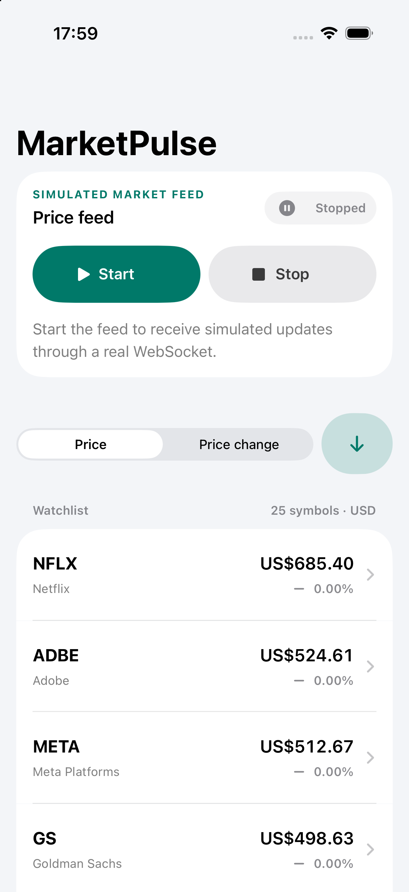
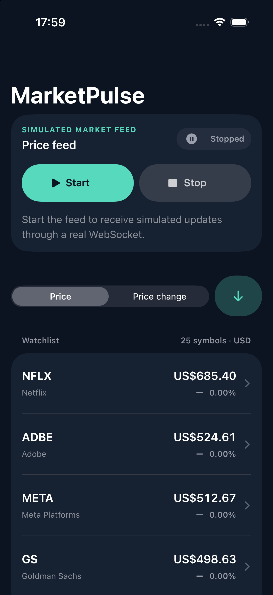
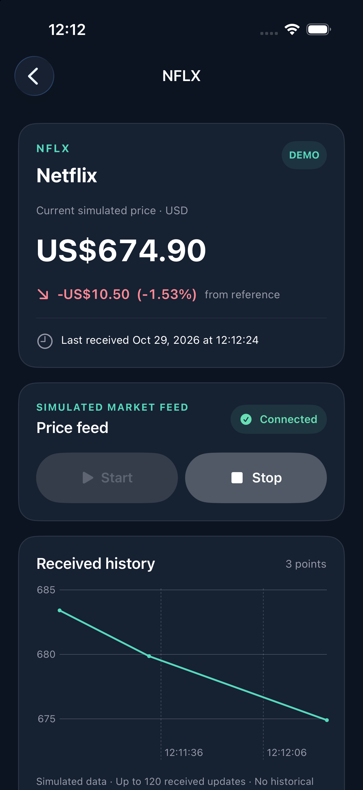
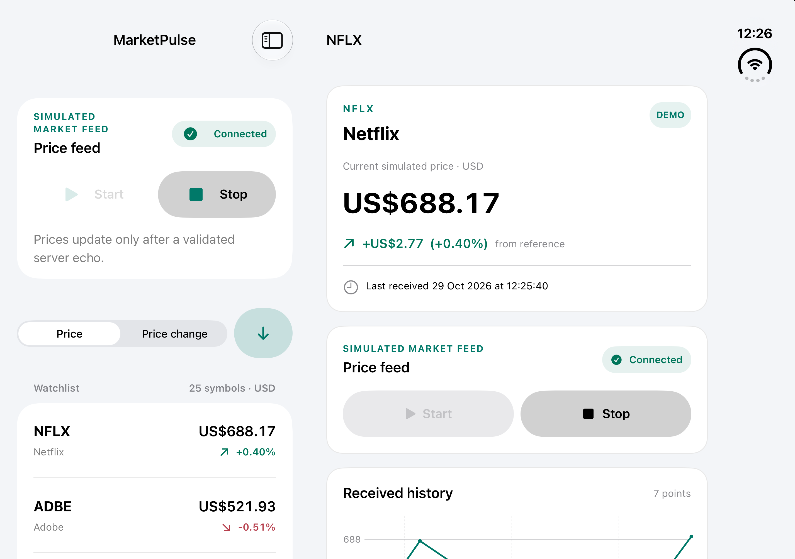

# MarketPulse

[](https://github.com/hassan789852/MarketPulse/actions/workflows/ios-ci.yml)

A native iOS stock-price tracker built for a Senior iOS Engineer assessment. **All prices are fictional simulated USD values.** This app is not affiliated with a bank, exchange or market-data provider.

## What it does

- Displays 25 companies with ticker, company name, current simulated price and signed movement.
- Sends one client-generated price update per second through **`wss://ws.postman-echo.com/raw`**. A visible quote changes **only after the server echoes the outstanding message and all validation succeeds**.
- Sorts by current price or signed percentage change, ascending or descending. Ties always use ticker ascending.
- Shares one live quote model between the watchlist and details. Details include company information, update time and a bounded chart of received updates.
- Provides explicit Start, Stop, connection status, automatic bounded retries and honest disconnected states.
- Uses native adaptive navigation, light/dark appearances, Dynamic Type, VoiceOver semantics and Reduced Motion support.

## Screenshots

These are actual simulator captures of the normal app. The updated watchlists show the initial stopped state with fictional reference prices; the details capture shows history received through Postman. All prices remain simulated.

| Watchlist · Light | Watchlist · Dark | Company details |
|---|---|---|
|  |  |  |

Additional accessibility, landscape and adaptive captures are documented in [the screenshot index](Docs/Screenshots/README.md).

[Watch the actual simulator demonstration](Docs/Videos/MarketPulse-full-demo-2026-10-29.mp4) (3 minutes 32 seconds; normal Release app, real WebSocket echoes, both appearances).



## Open and run

Open **`MarketPulse.xcodeproj`**, select the shared **MarketPulse** scheme and an installed iPhone or iPad simulator. No project generator, package download, API key or third-party library is required.

```sh
git clone https://github.com/hassan789852/MarketPulse.git
cd MarketPulse
open MarketPulse.xcodeproj
```

- Deployment target: **iOS 18.0**.
- Language mode: **Swift 6**, complete strict concurrency, Swift warnings treated as errors.
- Development machine: Xcode 27.1 / Swift 6.4 / iOS 27.1 SDK.
- A Swift 6-capable Xcode is required. CI uses an available stable hosted Xcode; full iPhone Duo system integration requires Xcode 27.1 or later.
- For a physical device, choose your own development team in Xcode. Simulator validation requires no credentials.

From this directory:

```sh
xcodebuild -list -project MarketPulse.xcodeproj
xcrun simctl list devices available
```

Use an actual installed device UUID in place of `YOUR_SIMULATOR_UUID`:

```sh
xcodebuild build \
  -project MarketPulse.xcodeproj -scheme MarketPulse \
  -destination 'platform=iOS Simulator,id=YOUR_SIMULATOR_UUID' \
  -derivedDataPath /tmp/MarketPulseDerived CODE_SIGNING_ALLOWED=NO

xcodebuild test \
  -project MarketPulse.xcodeproj -scheme MarketPulse \
  -destination 'platform=iOS Simulator,id=YOUR_SIMULATOR_UUID' \
  -derivedDataPath /tmp/MarketPulseDerived \
  -parallel-testing-enabled NO -collect-test-diagnostics never \
  CODE_SIGNING_ALLOWED=NO
```

Add `-only-testing:MarketPulseTests` for unit tests or `-only-testing:MarketPulseUITests` for the UI suite. Actual commands, outcomes and remaining limitations are recorded in [VALIDATION.md](VALIDATION.md).

The independent final review, fresh build/test evidence and remaining verification limits are recorded in [AUDIT.md](AUDIT.md).

## The echo contract

Postman is an **echo service**, not a stock exchange. The client generates a plausible price candidate, registers it as pending, sends JSON, receives the server's response and validates it before publishing the price:

```json
{
  "schemaVersion": 1,
  "type": "price_update",
  "sessionId": "11111111-1111-1111-1111-111111111111",
  "messageId": "22222222-2222-2222-2222-222222222222",
  "sequence": 42,
  "symbol": "AAPL",
  "price": "189.42",
  "sentAt": "2026-10-29T10:00:00.000Z"
}
```

Prices are Decimal values with cent precision. Reference prices in the catalog are fictional constants, not verified historical prices. Change is measured from each initial reference value, and percentage sorting uses that signed relative change. A round-robin schedule gives every symbol an update opportunity once per 25 seconds. Movement is bounded to ±0.8% per candidate before cent rounding, with a positive price floor and ceiling.

Malformed, oversized, unknown-symbol, unsupported-version, duplicate, out-of-order, stale-session and unsolicited frames are rejected. Even correctly structured messages must match an outstanding sent candidate exactly. Only accepted echoes enter the chart, which retains at most 120 points per stock.

## Connection behavior

Start waits for URLSession's successful WebSocket delegate callback before showing Connected. It creates one connection and one send/receive pair. Repeated Start is idempotent. A connected transport may still be awaiting its first echo; the update count and timestamps make that distinction visible.

Stop invalidates the session, cancels production/retries and closes the socket, while retaining the last valid prices. Backgrounding pauses networking and preserves the user's running intent; foregrounding reconnects only if the feed was requested. Manual Stop always clears that intent.

Unexpected failures use five exponential retries with jitter (maximum delay 20 seconds). The initial handshake times out after 12 seconds; outstanding echoes time out after 15 seconds. After retry exhaustion, Retry starts a fresh attempt. A network outage never activates an automatic fake feed or labels seeded values as live.

## Testing without external dependencies

The unit suite injects a manually controlled WebSocket, clock and randomness. It asserts that sending alone never changes public quotes, then explicitly delivers echoes. It also covers lifecycle, replay rejection, ordering, session replacement, backoff, financial precision, fair generation, sorting and shared presentation state.

UI tests launch Debug with **`--ui-testing`** to inject a deterministic in-memory echo transport. **`--ui-test-failure`** additionally simulates an unavailable service. The fake transport is compiled out of Release and is never chosen by a normal app launch. This makes routine tests and CI independent of Postman's availability.

For an explicit real-network diagnostic using the exact production Domain/Data sources:

```sh
xcrun swiftc -swift-version 6 -strict-concurrency=complete -parse-as-library \
  -module-cache-path /tmp/MarketPulseSwiftCache \
  Domain/Models/*.swift Domain/Protocols/*.swift Domain/Services/*.swift \
  Data/Catalog/*.swift Data/Networking/*.swift Data/Repositories/*.swift \
  Data/Simulation/*.swift Tools/VerifyEcho.swift -o /tmp/marketpulse-verify-echo
/tmp/marketpulse-verify-echo
```

The diagnostic exits successfully only after three production-server echoes and Stop. Add `--extended` to require 75 echoes and exercise a connection for longer than one minute. It requires network access and is deliberately excluded from CI.

## Architecture and adaptive UI

The repository actor owns all prices and connection state. A transport actor owns each URLSession socket. An observable MainActor projection exposes stable per-stock models to both screens. Domain code imports Foundation, not SwiftUI. Dependencies are composed in `AppContainer`; no service locator or third-party framework is involved. See [ARCHITECTURE.md](ARCHITECTURE.md) for boundaries, the sequence diagram and production extension points.

`NavigationSplitView` collapses to normal single-column navigation and expands to a watchlist/detail arrangement. Selection and feed ownership live above the columns. Layout uses size classes and available content space, with no device-name or global-screen checks. This follows [Apple's iPhone Duo preparation guidance](https://developer.apple.com/iphone-duo/prepare/) and [adaptive-layout tech talk](https://developer.apple.com/videos/play/tech-talks/111461/). Actual tested poses and screenshots, rather than assumed support, are listed in the validation report.

The app intentionally supports one scene, so one foreground/background lifecycle owns the shared feed. A future multi-window edition would aggregate scene activity before pausing the repository.

## CI and repository preparation

`.github/workflows/ios-ci.yml` builds and runs unit and deterministic UI tests on `macos-15`, chooses an installed stable Xcode and an available supported simulator, and preserves `.xcresult` artifacts. The [hosted image inventory](https://github.com/actions/runner-images/blob/main/images/macos/macos-15-Readme.md) informs the preferred toolchain. No secrets, SDK downloads or Duo runtime assumptions are required. Check the [actual workflow runs](https://github.com/hassan789852/MarketPulse/actions/workflows/ios-ci.yml) and [validation record](VALIDATION.md) for verified results; local passes do not establish a hosted CI pass.

[Verified hosted run](https://github.com/hassan789852/MarketPulse/actions/runs/41030613961): **27 unit-test functions + 5 UI tests passed**, with zero failures/skips, on Xcode 26.3 / Swift 6.2.4 and iPhone SE (3rd generation) / iOS 26.2. The badge above reflects current workflow status; the validation record identifies the tested commit and retained evidence.

This directory is the standalone repository root. Generated builds and private signing material are ignored. No external dependencies or generator are needed to open the checked-in Xcode project.

No open-source license has been selected. [NOTICES.md](NOTICES.md) records the current licensing status and platform/service attribution; publication does not implicitly grant a license.

## Limits and sensible next steps

This is a foreground demonstration, not a trading system. The public echo service has no service-level guarantee. There is no persistence across launches, real exchange integration, trading calendar, order execution, account handling or investment advice. The USD-only catalog and English descriptions are intentional. The interface is currently English only: it uses localization-capable APIs, but `Localizable.xcstrings` has no entries or translations. Currency and percentage formatting follow the current locale. Arabic text translation and full RTL validation remain optional future work.

The retained Duo captures document earlier closed/open/partially-open poses and rotation. The final audit inspected those captures, but its fresh Duo attempt reported a data-migration failure and a black expanded surface, so it could not independently repeat the pose checks. Freeform resizing and OS Split View remain visually unverified. Physical-device checks and production-transport failure injection are also outstanding; see [AUDIT.md](AUDIT.md). Hosted iPhone CI does not verify Duo-specific behavior.

Production adaptation would introduce an authenticated data source, subscription/replay semantics, exchange timestamps/calendars, observability and operational policies. These are extension points, not simulated production guarantees. See the validation report for current device-test coverage.

## Two-minute demo

1. Launch the normal app: show the simulated-data disclosure and 25-symbol watchlist.
2. Tap Start: show Connecting, then Connected after the handshake, and received price movement.
3. Switch Price / Price change and reverse the sort direction.
4. Open a symbol: show the same price, reference-based change, company description and received history.
5. Tap Stop: prices remain fixed and state changes to Stopped. Start again.
6. If the Duo simulator renders normally, show both columns and fold to demonstrate selection continuity. Freeform resizing remains an outstanding validation item.
